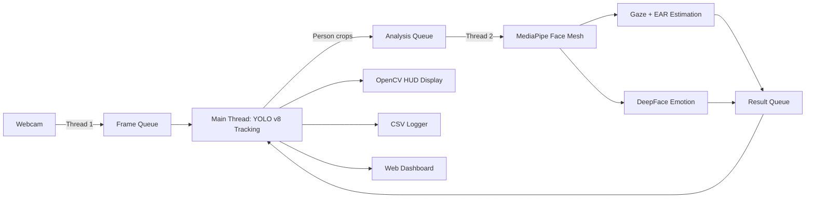

# Ultimate Emotion & Attention AI — Project Walkthrough

**Date:** February 28, 2026
**Project Location:** `C:\Users\Admin\.gemini\antigravity\scratch\emotion_tracker\`

---

## Project Overview

Built a **real-time facial emotion & attention tracking system** from scratch, iterating through multiple versions to create a production-quality computer vision application with multi-model AI, multi-threaded architecture, and a web dashboard.

---

## Architecture



---

## Files Created

| File | Purpose |
|---|---|
| [main.py](file:///C:/Users/Admin/.gemini/antigravity/scratch/emotion_tracker/main.py) | Core application (~1040 lines) |
| [dashboard.py](file:///C:/Users/Admin/.gemini/antigravity/scratch/emotion_tracker/dashboard.py) | Flask web dashboard with Chart.js |
| [requirements.txt](file:///C:/Users/Admin/.gemini/antigravity/scratch/emotion_tracker/requirements.txt) | All Python dependencies |
| `models/` | Auto-downloaded model weights (DNN SSD, MediaPipe) |
| `logs/` | Session CSVs + alert screenshots |

---

## Build Timeline

### v1.0 — Basic Emotion Tracker
- OpenCV Haar Cascade face detection
- DeepFace emotion classification
- Simple bounding box + emotion label overlay

### v1.5 — Improved Accuracy
- Replaced Haar Cascade with **OpenCV DNN SSD** face detector
- Added **temporal smoothing** (sliding window of 7 frames)
- Added **face ROI padding** (25%) for better classification
- Used `detector_backend='skip'` to avoid redundant detection
- Added **frame skipping** (analyze every 3rd frame)
- Polished UI: rounded boxes, corner accents, emotion bars, FPS counter

### v2.0 — Merged Architecture (User's YOLO Code + Our Enhancements)
- **YOLO v8 Nano** for person detection + persistent ID tracking
- **MediaPipe FaceLandmarker** (468-point mesh) for gaze + head pose
- **DNN SSD fallback** when MediaPipe misses a face
- **Multi-threaded pipeline** (camera, analysis, display threads)
- **EMA bounding box smoothing** + **majority-vote emotion smoothing**
- **Sound alarm** + **email alerts** on distraction
- Clickable alarm toggle button in the HUD

### v2.1 — Standout Features
- **Drowsiness detection** via Eye Aspect Ratio (6 landmarks per eye)
- **Engagement Score gauge** (0–100): 40% gaze + 30% emotion + 30% alertness
- **Scrolling timeline graph** at the bottom of the video feed
- **CSV session logging** with timestamped data points
- **Auto-screenshot capture** on alert events (10s cooldown)
- **Session summary report** printed on exit

### v2.2 — Web Dashboard
- Created [dashboard.py](file:///C:/Users/Admin/.gemini/antigravity/scratch/emotion_tracker/dashboard.py) with Flask + Chart.js
- Dark glassmorphism UI
- Emotion distribution doughnut chart
- Attention vs distraction doughnut chart
- Engagement over time line chart
- Auto-refreshes every 5 seconds

### v2.3 — Refinements
- **Session summary email** with CSV attachment sent on exit
- **Removed real-time workstation alert emails** (too spammy)
- **CSV logging throttled** to every 5 seconds (was every frame)
- **Face preprocessing pipeline** for low-quality video:
  - LANCZOS4 upscaling of small face crops to 224×224
  - CLAHE contrast enhancement on luminance channel
  - Bilateral denoising filter (preserves edges)
- **Emotion history** increased to 12 frames for stability
- **Drowsiness** changed to **time-based**: 30 seconds of closed eyes
- **Distraction** changed to **time-based**: 20 seconds of looking away
- **CSV email attachment bug fixed** — file is now closed before reading

---

## Configuration Reference

All settings are at the top of `main.py` (lines 47–102):

| Setting | Value | Purpose |
|---|---|---|
| `YOLO_SKIP_FRAMES` | 3 | Run YOLO every N frames |
| `EMOTION_HISTORY_LEN` | 12 | Frames for majority-vote smoothing |
| `GAZE_PITCH_THRESHOLD` | 20° | Head tilt to flag looking away |
| `GAZE_YAW_THRESHOLD` | 20° | Head turn to flag looking away |
| `DISTRACTION_DURATION_SECONDS` | 20 | Seconds before distraction alert |
| `DROWSY_DURATION_SECONDS` | 30 | Seconds before drowsiness alert |
| `LOG_INTERVAL_SECONDS` | 5 | CSV logging frequency |
| `SCREENSHOT_COOLDOWN` | 10 | Seconds between auto-screenshots |
| `EAR_THRESHOLD` | 0.22 | Eye Aspect Ratio drowsy threshold |

## Keyboard Controls

| Key | Action |
|---|---|
| `q` | Quit (triggers summary email) |
| `d` | Toggle emotion debug bars |
| `f` | Toggle FPS counter |
| `g` | Toggle engagement timeline graph |
| Mouse click | Toggle alarm button |

---

## How to Run

**Main tracker:**
```shell
cd C:\Users\Admin\.gemini\antigravity\scratch\emotion_tracker
python main.py
```

**Web dashboard** (in a second terminal):
```shell
cd C:\Users\Admin\.gemini\antigravity\scratch\emotion_tracker
python dashboard.py
```
Then open **http://localhost:5000**
